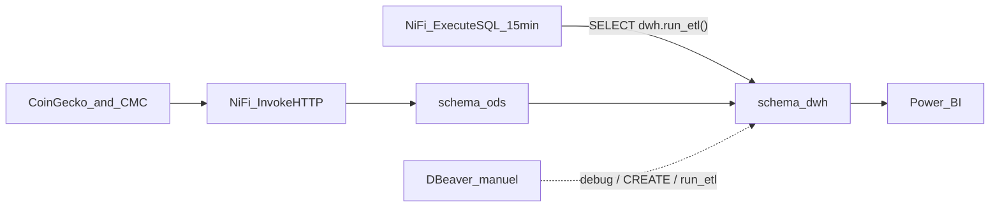
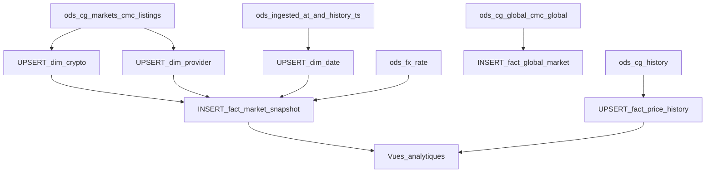
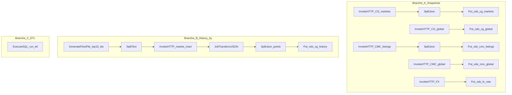

# Architecture : Flux NiFi + ODS → DWH

Documentation du pipeline BI cryptomonnaies (alignée sur le sujet [Projet BI.pdf](Projet%20BI.pdf) et l’implémentation du dépôt).

## Objectif

Chaîne décisionnelle :

**CoinGecko + CoinMarketCap → Apache NiFi → PostgreSQL (`ods`) → SQL ETL (`dwh`) → Power BI**

Couvre notamment :

- Top 10 / Top 100 (prix, capitalisation, volume) en USD et EUR
- Performances 7j / 3m / 6m / 12m / 5 ans
- Comparaison entre fournisseurs (écarts volume / capitalisation)
- Données globales du marché (tokens, exchanges, cap, volume, % Top 10 / Top 100)

---

## Vue d’ensemble

**Même instance PostgreSQL**, deux schémas (`ods` et `dwh`), pas deux bases séparées.



| Couche | Rôle |
|--------|------|
| **NiFi (collecte)** | Appels API + INSERT brut dans `ods` (pattern du TD weather) |
| **SQL (`dwh.run_etl()`)** | Nettoyage, modèle dimensionnel, faits, vues analytiques |
| **NiFi (ExecuteSQL)** | Planifie `SELECT dwh.run_etl();` toutes les **15 min** |
| **DBeaver** | Création initiale du schéma, debug, relance manuelle de l’ETL |

Pourquoi SQL + trigger NiFi (et pas tout transformer en processors) : le sujet demande des scripts SQL pour le warehouse ; NiFi ne fait que **planifier** l’appel, sans dupliquer la logique ETL. Pas de `pg_cron` (extension souvent absente en local).

---

## 1. Base PostgreSQL

Base : `crypto_bi` (user `bernardo`, `localhost:5432`).

Scripts (à exécuter dans DBeaver) :

| Fichier | Rôle |
|---------|------|
| [`sql/01_create_db.sql`](../sql/01_create_db.sql) | `CREATE DATABASE crypto_bi` |
| [`sql/02_ods_tables.sql`](../sql/02_ods_tables.sql) | Tables ODS |
| [`sql/03_dwh_tables.sql`](../sql/03_dwh_tables.sql) | Dimensions + faits |
| [`sql/04_etl_ods_to_dwh.sql`](../sql/04_etl_ods_to_dwh.sql) | Fonction `dwh.run_etl()` + vues |

### Schéma `ods` (cible NiFi)

| Table | Source API | Contenu |
|-------|------------|---------|
| `ods.cg_markets` | CoinGecko `/coins/markets` | Top 100 : coin_id, symbol, name, prix, cap, volume, rank, price_change_*, ingested_at |
| `ods.cmc_listings` | CMC `/v1/cryptocurrency/listings/latest` | Top 100 : cmc_id, symbol, name, prix, cap, volume_24h, rank, percent_change_*, ingested_at |
| `ods.cg_global` | CoinGecko `/global` | Cap / volume globaux, nb cryptos, nb markets |
| `ods.cmc_global` | CMC `/v1/global-metrics/quotes/latest` | Cap / volume, nb cryptos, nb exchanges |
| `ods.fx_rate` | CoinGecko `/exchange_rates` | Taux `usd_eur` |
| `ods.cg_history` | CoinGecko `/coins/{id}/market_chart?days=1825` | Série journalière (Top 10) : ts_ms, price, cap, volume |

Colonnes alignées sur les attributs extraits par `EvaluateJsonPath` (comme `weather_data` du TD).

### Schéma `dwh` (étoile)

**Dimensions**

- `dim_date` — date_sk (YYYYMMDD), year, month, day, week, is_weekend
- `dim_provider` — `coingecko` / `coinmarketcap`
- `dim_crypto` — symbol unifié, name, `coingecko_id`, `cmc_id`

**Faits**

- `fact_market_snapshot` — prix / cap / volume USD+EUR, rank, perfs API, FK date / provider / crypto
- `fact_global_market` — cap, volume, nb tokens, nb exchanges, `pct_cap_top10`, `pct_cap_top100`
- `fact_price_history` — série journalière 5 ans (depuis `ods.cg_history`)

**Vues analytiques**

- `dwh.v_top10` / `dwh.v_top100`
- `dwh.v_provider_gap` — % écart volume et capitalisation CG vs CMC
- `dwh.v_best_performers` — perfs 7j / 3m / 6m / 12m / 5y
- `dwh.v_latest_snapshot` — dernier snapshot par fournisseur

---

## 2. Conversion ODS → DWH (`dwh.run_etl()`)

Fichier : [`sql/04_etl_ods_to_dwh.sql`](../sql/04_etl_ods_to_dwh.sql).

Script ré-exécutable ; automation via NiFi `ExecuteSQL` (`SELECT dwh.run_etl();`).



### Étapes (ordre fixe)

1. **Taux FX** — dernier `ods.fx_rate.usd_eur` (fallback `0.92` si vide).
2. **`dim_provider`** — upsert `coingecko`, `coinmarketcap`.
3. **`dim_crypto`** — depuis CG (`coingecko_id` + symbol) puis merge CMC sur `symbol` (`cmc_id`) ; `ON CONFLICT (symbol) DO UPDATE`.
4. **`dim_date`** — dates distinctes des `ingested_at` ODS + timestamps history.
5. **`fact_market_snapshot`** — insert-only des nouveaux `ingested_at` (CG puis CMC) ; `price_eur = price_usd * fx`.
6. **`fact_global_market`** — insert-only ; calcul `%` Top 10 / Top 100 vs cap totale.
7. **`fact_price_history`** — upsert depuis `ods.cg_history` (`ON CONFLICT (crypto_sk, price_date)`).
8. **Vues** — Top, gaps fournisseurs, best performers.

Relance manuelle :

```sql
SELECT dwh.run_etl();
```

---

## 3. Flux NiFi

Fichier importable : [`NiFi/project.json`](../NiFi/project.json)  
Inspiration TD : [`NiFi/td_weather_3.json`](../NiFi/td_weather_3.json)  
Régénération : `python3 scripts/generate_nifi_flow.py`

### Branches

| Branche | Rôle | Schedule |
|---------|------|----------|
| **A — Snapshots** | Top 100 + global CG/CMC + FX → `ods.*` | 5 min |
| **B — History** | Top 10 `market_chart` 1825 j → `ods.cg_history` | Manuel (DISABLED par défaut) |
| **C — ETL** | `SELECT dwh.run_etl();` → `dwh.*` | 15 min |



### Pattern processors (branche A)

Comme le TD weather, avec `SplitJson` pour les tableaux et horodatage commun :

`InvokeHTTP → UpdateAttribute(ingested_at) → [SplitJson] → EvaluateJsonPath → AttributesToJSON → ConvertRecord → PutDatabaseRecord`

### Endpoints

- CG markets : `/api/v3/coins/markets?vs_currency=usd&order=market_cap_desc&per_page=100&price_change_percentage=7d,30d,1y`
- CG global : `/api/v3/global`
- CMC listings / global : Pro API + header `X-CMC_PRO_API_KEY`
- FX : `/api/v3/exchange_rates`
- Historique : `/api/v3/coins/${coin_id}/market_chart?vs_currency=usd&days=1825&interval=daily`

### Historique 5 ans (branche B)

Contraintes et choix :

1. **Rate limits** — 1 appel par coin ; Top 10 seulement, délai ~12 s entre appels.
2. **JSON en séries** — `prices: [[ts, value], …]` → Jolt + SplitJson pour obtenir des lignes ODS.
3. **CMC historique** souvent payant → série 5 ans via **CoinGecko seul** ; CMC reste pour snapshots et gaps.

Liste fixe Top 10 dans `GenerateFlowFile` (bitcoin, ethereum, tether, …). Processors **DISABLED** à l’import : démarrer une fois après les snapshots.

### Config (héritée du TD)

- DBCP : `jdbc:postgresql://localhost:5432/crypto_bi`, user `bernardo`
- Driver : jar PostgreSQL sous Homebrew NiFi (`…/libexec/lib/postgresql-*.jar`)
- `PutDatabaseRecord` : schema `ods`, Translate Field Names + `REMOVE_UNDERSCORE`
- Clé CMC : placeholder `REPLACE_WITH_CMC_API_KEY` — prendre la valeur dans `.env`, **ne pas committer**

---

## 4. Ordre de mise en route

1. Exécuter les SQL `01` → `04` dans DBeaver (crée tables + `dwh.run_etl`).
2. Importer [`NiFi/project.json`](../NiFi/project.json) ; password JDBC + clé CMC ; activer les Controller Services.
3. Démarrer **branche A** ; vérifier `ods.cg_markets` / `ods.cmc_listings`.
4. Démarrer **branche B** une fois ; vérifier `ods.cg_history`.
5. Démarrer **branche C** (ou un premier `SELECT dwh.run_etl();` manuel).
6. Brancher Power BI sur les tables / vues `dwh.*`.

Guide opérationnel court : [`README.md`](../README.md).

---

## 5. Correspondance avec le sujet PDF

| Exigence PDF | Couverture |
|--------------|------------|
| Top 10 / Top 100 (prix, cap, volume) | `ods.*` + `dwh.v_top10` / `v_top100` |
| Meilleures perfs 7j, 3/6/12 mois, 5 ans | `dwh.v_best_performers` (+ champs % API sur snapshots) |
| Comparer fournisseurs (gap volume / cap) | `dwh.v_provider_gap` |
| Données globales marché | `fact_global_market` (tokens, exchanges, cap, volume, % Top10/100) |
| USD et EUR | FX `ods.fx_rate` + colonnes `*_eur` dans les faits |
| Collecte NiFi + ODS PostgreSQL | Branche A → schema `ods` |
| Modèle dimensionnel + scripts SQL | Schema `dwh` + `dwh.run_etl()` |
| Power BI | Connexion aux vues / faits `dwh` |
